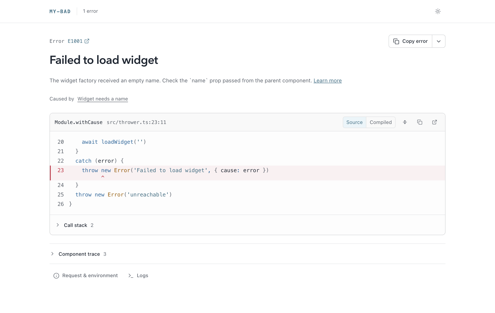
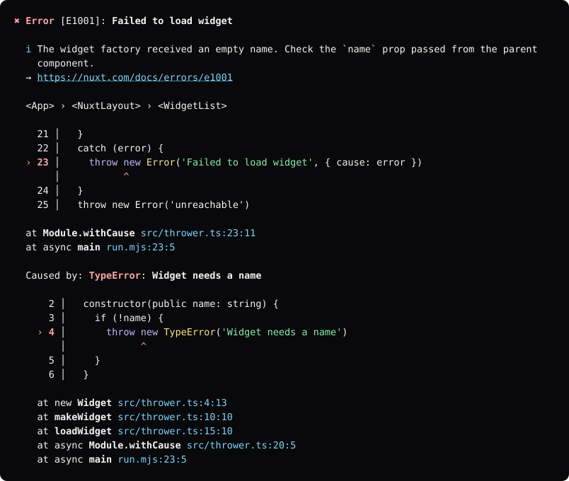
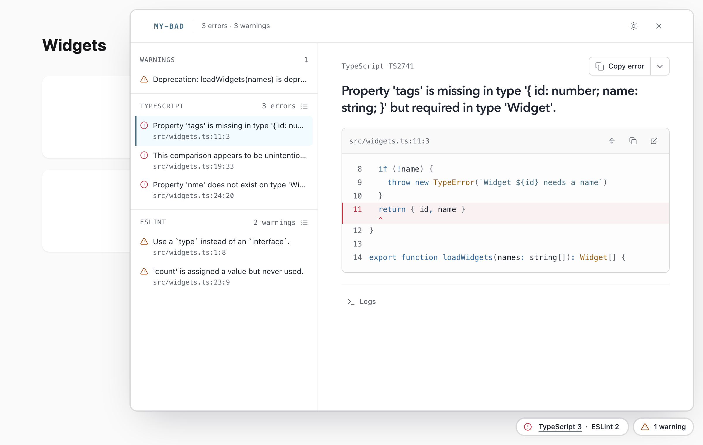
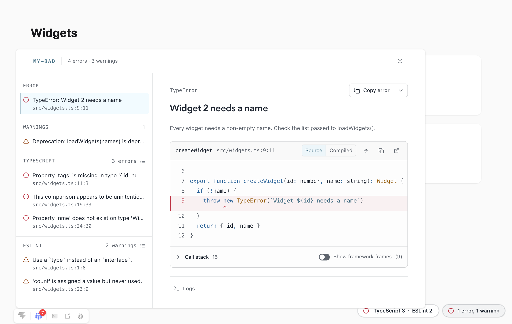

# my-bad

[![npm version][npm-version-src]][npm-version-href]
[![npm downloads][npm-downloads-src]][npm-downloads-href]
[![Github Actions][github-actions-src]][github-actions-href]
[![Codecov][codecov-src]][codecov-href]

> Beautiful dev-server error pages rendered to HTML, ANSI or JSON and live updated over SSE. ✨

`my-bad` turns an error into a plain JSON report with sourcemapped frames, snippets, causes, component trace and request context, then renders it as a full HTML page, an overlay for an existing page, or ANSI for the terminal. A small live channel keeps every page up to date as errors are fixed, and surfaces warnings, logs and diagnostics from other tools as they occur.

<picture>
  <source media="(prefers-color-scheme: dark)" srcset="https://raw.githubusercontent.com/danielroe/my-bad/main/assets/page-dark.png">
  
</picture>

The same report in the terminal, with `renderAnsi`:



`renderBadge` adds a small loader to every dev page. It renders nothing until something concerns the page: an error mounts the overlay, warnings show a count, and problem sets from type checkers and linters get a pill of their own that opens beside the page.

<picture>
  <source media="(prefers-color-scheme: dark)" srcset="https://raw.githubusercontent.com/danielroe/my-bad/main/assets/drawer-dark.png">
  
</picture>

With [Vite DevTools](https://github.com/vitejs/devtools) installed, the Vite plugin adds a my-bad dock listing the open error, the warnings and every problem set.

<picture>
  <source media="(prefers-color-scheme: dark)" srcset="https://raw.githubusercontent.com/danielroe/my-bad/main/assets/devtools-dark.png">
  
</picture>

## Install

```sh
npm install my-bad
```

## Usage

With Vite, add the plugin. It maps frames through the module graph, shows compile errors in an overlay, and mounts the live channel at `/__my-bad`.

```ts
import { myBad } from 'my-bad/vite'

export default defineConfig({
  plugins: [
    myBad()
  ]
})
```

Anywhere else, build a report and render it:

```ts
import { createReport, renderAnsi, renderPage } from 'my-bad'

const report = await createReport(error, {
  cwd: process.cwd()
})

console.error(renderAnsi(report))

if (req.headers.accept?.includes('text/html')) {
  res.end(renderPage(report, {
    cwd: process.cwd(),
    channel: '/__my-bad'
  }))
}
else {
  res.end(JSON.stringify(report))
}
```

Type checkers, linters and audits can publish their current diagnostics to the channel, and every page with the badge picks them up:

```ts
import { createProblemReport } from 'my-bad'

channel.setProblems('lint', results.map(result => createProblemReport({
  name: 'ESLint',
  message: result.message,
  code: result.ruleId,
  file: result.file,
  line: result.line,
  column: result.column,
  kind: result.severity === 2
    ? 'error'
    : 'warning',
})), { label: 'ESLint', url: '/__lint/' })
```

## Documentation

- [Reports](https://github.com/danielroe/my-bad/blob/main/docs/reports.md): diagnostics, sourcemaps, compile errors, syntax highlighting and presets
- [Rendering](https://github.com/danielroe/my-bad/blob/main/docs/rendering.md): the page, overlay, badge, theming and terminal output
- [Live channel](https://github.com/danielroe/my-bad/blob/main/docs/channel.md): mounting, trust, publishing and problem sets
- [Vite](https://github.com/danielroe/my-bad/blob/main/docs/vite.md): the plugin and the Vite DevTools dock

## 💻 Development

```bash
git clone git@github.com:danielroe/my-bad.git
corepack enable

# run interactive tests
pnpm dev
# run accessibility audit (computed contrast, axe-core, target sizes, focus, motion, reflow)
pnpm test:a11y
# render screenshots of the ui
pnpm screenshot

# re-render the README assets in assets/ (autofix.ci keeps these current)
pnpm assets
# experiment in the playground
pnpm play
pnpm play:vite
```

## Credits

This was inspired by [youch](https://github.com/poppinss/youch), which is a phenomenal error page generator, and I would highly recommend it!

## License

Made with ❤️

Published under [MIT License](./LICENCE).

<!-- Badges -->

[npm-version-src]: https://npmx.dev/api/registry/badge/version/my-bad
[npm-version-href]: https://npmx.dev/package/my-bad
[npm-downloads-src]: https://npmx.dev/api/registry/badge/downloads/my-bad
[npm-downloads-href]: https://npm.chart.dev/my-bad
[github-actions-src]: https://img.shields.io/github/actions/workflow/status/danielroe/my-bad/ci.yml?branch=main&style=flat-square
[github-actions-href]: https://github.com/danielroe/my-bad/actions?query=workflow%3Aci
[codecov-src]: https://img.shields.io/codecov/c/gh/danielroe/my-bad/main?style=flat-square
[codecov-href]: https://codecov.io/gh/danielroe/my-bad
