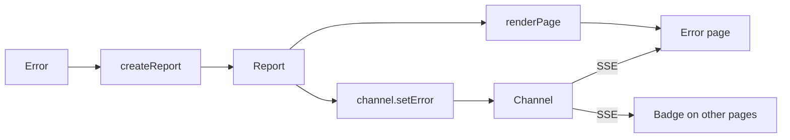

# Integrate with a dev server

This guide shows you how to add `my-bad` to a dev server that you control, such as the dev server of a framework or CLI. If your project uses Vite directly, the [Vite plugin](./vite.md) does these steps for you.

You need a Node.js HTTP server, or a server that handles Fetch API `Request` objects.

## How the pieces connect

A request fails, and your server turns the error into a report. The server responds with an error page and publishes the report to the live channel. The channel streams it to every open page that it concerns.

The following diagram shows how a report reaches the browser:



## Add my-bad to your server

To add `my-bad` to a Node.js server:

1. Create a channel when the dev server starts:

   ```ts
   import { createChannel } from 'my-bad/channel'

   const channel = createChannel({ open: true })
   ```

   `open: true` lets pages open a file in your editor. See [Open files in an editor](./channel.md#open-files-in-an-editor).

2. Pass requests under the channel base path to `channel.handler`. It resolves `true` when it handled the request:

   ```ts
   const server = createServer(async (req, res) => {
     if (req.url?.startsWith('/__my-bad/') && await channel.handler(req, res)) {
       return
     }
     await handleApp(req, res)
   })
   ```

   In this example, `handleApp` stands for your app. The handler routes on the end of the path, so only give it requests under the base path. For a Fetch API server, use `channel.fetchHandler(request)` instead.

3. When a request fails, build a report, publish it, and respond with an error page:

   ```ts
   import { createReport, renderPage } from 'my-bad'
   import { requestPreset } from 'my-bad/presets'

   const requestId = crypto.randomUUID()
   const report = await createReport(error, {
     cwd,
     presets: [
       requestPreset()
     ],
     context: { req },
   })

   channel.setError(report, requestId, `${req.method} ${req.url}`)

   res.statusCode = 500
   res.setHeader('content-type', 'text/html')
   res.end(renderPage(report, {
     cwd,
     channel: '/__my-bad',
     requestId,
   }))
   ```

   The request id links the page to the error. The channel then sends this page the errors from its own request, and errors from no request. See [Errors and requests](./channel.md#errors-and-requests).

4. Add the badge to every page that your server renders:

   ```ts
   import { renderBadge } from 'my-bad'

   const html = `<!DOCTYPE html>
   <html>
   <head>${renderBadge({ channel: '/__my-bad' })}</head>
   <body>${body}</body>
   </html>`
   ```

   The badge renders nothing until an error, a warning, or a problem concerns the page. Without a `requestId`, the badge matches errors from a request by the path of the page. On untrusted pages, it never matches an error with a `requestId` this way. To match those errors, render the badge with a `requestId`, and publish errors from that request with the same id.

5. Retire the error when the code that failed changes, for example after a rebuild succeeds:

   ```ts
   channel.clearError()
   ```

   Error pages reload. Overlays close, and the badge dispatches a `my-bad:error:clear` event on `window`.

6. Optional: print the report to the terminal:

   ```ts
   import { renderAnsi } from 'my-bad'

   console.error(renderAnsi(report, { cwd }))
   ```

## Publish errors that happen outside a request

Compile errors and client runtime errors don't belong to a request. Publish them without a request id, and they reach every page:

```ts
channel.setError(await createReport(error, { cwd, kind: 'compile' }))
```

An error from no request replaces every open error. An error with a request id replaces only earlier errors from the same request.

## Show the error on an existing page

If your framework renders its own error page, inject the overlay into it instead of responding with `renderPage`:

```ts
import { injectOverlay } from 'my-bad'

res.end(injectOverlay(html, report, { channel: '/__my-bad', requestId }))
```

The overlay renders in a shadow root, so the page styles don't affect it. See [Overlay](./rendering.md#overlay).

## Publish warnings and logs

Warnings and logs also go through the channel:

```ts
channel.warn(await createReport(warning, { cwd, kind: 'warning' }))
channel.log({ level: 'info', text: 'GET /widgets 200 12ms' }, requestId, 'GET /widgets')
```

Pages count each warning until you retire it with `channel.clearWarning(id)`. See [Publish reports](./channel.md#publish-reports).

## Reach the channel from another machine

By default, the channel trusts only callers on the same machine. If you bind the dev server to a network address, or run it in a container, read [Who can use the channel](./channel.md#who-can-use-the-channel).

## Next steps

- [Rendering](./rendering.md): theme the page, choose where the overlay docks, and serve the client assets separately.
- [Reports](./reports.md): add source loaders and presets for your runtime.
- [Publish problems](./problems.md): show type checker and linter results on every page.
