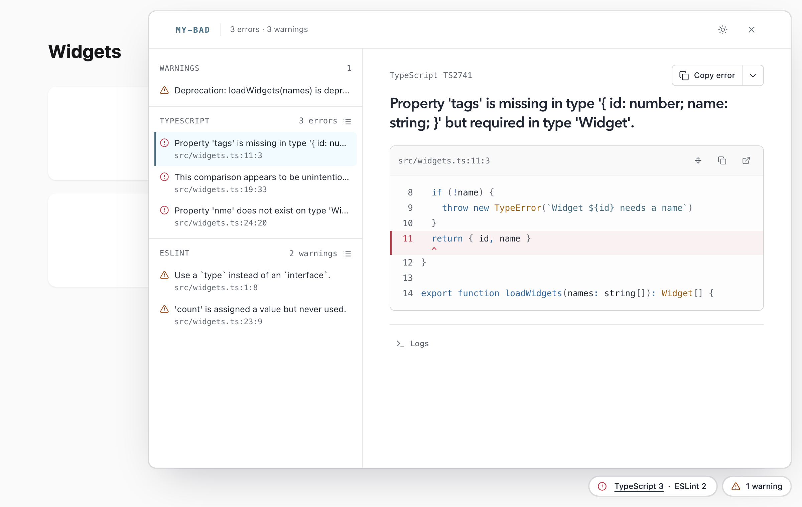

# Publish problems

A problem set holds the current diagnostics of one long-running source, such as a type checker, a linter, or an audit. This guide shows you how to publish a set to the live channel, and how pages show it.

You need a [live channel](./channel.md). With Vite, use `useMyBad(server).channel`. See [Use with Vite](./vite.md#render-server-errors).

## How problem sets differ from errors

An error takes over the page until it's fixed. Problems don't interrupt you, so a tool can publish them after every run:

- Problem sets stay out of the history, and don't count towards the warning limit.
- They raise no toasts, and never take over a page.
- Every page shows a count for each source, in a pill beside the badge.
- Selecting an entry in the pill opens its problems in a drawer beside the page.
- New problems grow the pill into a card for a few seconds. The card shows the first new problem, and how many more arrived with it.

The card shows only on pages that the channel sends reports to. See [Trusted and untrusted callers](./channel.md#trusted-and-untrusted-callers).

<picture>
  <source media="(prefers-color-scheme: dark)" srcset="https://raw.githubusercontent.com/danielroe/my-bad/main/assets/drawer-dark.png">
  
</picture>

The pill shows problems only on pages that render the badge. See [Badge](./rendering.md#badge).

## Publish a problem set

Map the results of each run to reports, and publish the whole set with `setProblems`. A new set from the same source replaces the earlier one.

`createProblemReport` builds a report from a diagnostic that a tool has already located. It doesn't read any files:

```ts
import { createProblemReport } from 'my-bad'

channel.setProblems('lint', results.map(result => createProblemReport({
  name: 'ESLint',
  message: result.message,
  code: result.ruleId,
  file: result.file,
  line: result.line,
  column: result.column,
  snippet: result.codeFrame,
  kind: result.severity === 2
    ? 'error'
    : 'warning',
})), { label: 'ESLint', url: '/__lint/' })
```

`createProblemReport` takes these fields:

| Field | Description |
| --- | --- |
| `name` | Heads the report when it's opened. |
| `message` | The diagnostic. |
| `code` | For example a rule name or `TS2322`. |
| `docsUrl` | Link to the documentation of the diagnostic. |
| `file` | Absolute, or relative to `cwd`. |
| `line`, `column` | Position in `file`. |
| `kind` | `error` or `warning`. Default `error`. |
| `snippet` | A `Snippet`, or a code frame of `3 \| code` lines. A code frame can mark a line with `>`. |

A report without a `file` or a `snippet` has no frames. As a second argument, `createProblemReport` takes `cwd`, `tokenizer`, `maxMessageLength`, and `maxSnippetLineLength`.

If you want `my-bad` to read the snippet from disk, use `createReport` instead. Pass the location as a compile-shaped input (`{ message, loc }`), or as `sources`, and set `kind: 'warning'` for warnings.

### Names in the problem list

The drawer and the DevTools dock list each problem under the `label` of its set. A `name` that only repeats the label is left out of the row, ignoring case. Any other `name`, such as `TS2322`, shows before the message.

## Report the lifecycle of a run

Tell pages when a source is checking, and when it fails. This example follows a linter in watch mode:

```ts
import type { ErrorReport } from 'my-bad'
import { createProblemReport } from 'my-bad'

const meta = { label: 'ESLint', url: '/__lint/' }
let reports: ErrorReport[] = []

linter.on('start', () => {
  channel.setProblems('lint', reports, { ...meta, status: 'checking' })
})

linter.on('results', (results) => {
  reports = results.map(result => createProblemReport({
    name: 'ESLint',
    message: result.message,
    file: result.file,
    line: result.line,
    column: result.column,
    kind: result.severity === 2
      ? 'error'
      : 'warning',
  }))
  channel.setProblems('lint', reports, meta)
})

linter.on('crash', (error) => {
  channel.setProblems('lint', reports, { ...meta, status: 'failed', error: error.message })
})

linter.on('close', () => {
  channel.clearProblems('lint')
})
```

In this example, `linter` stands for the tool you integrate. The same approach fits any tool with a run lifecycle, such as an accessibility audit or the `api.subscribe` server API of vite-plugin-checker.

The pill shows each status like this:

- **`checking`**: a spinner. While a run with no problems is checking, the pill stays hidden.
- **`idle`**: the count of errors and warnings. A source without a status is idle.
- **`failed`**: `failed` in place of the count, with the `error` reason in the title of the pill.

An empty set shows nothing, but the source stays listed with its metadata.

## Problem metadata

The third argument of `setProblems` describes the source:

| Field | Description |
| --- | --- |
| `label` | Name of the source, for example `TypeScript`. Without it, pages show the `source`. |
| `status` | `checking`, `idle`, or `failed`. Default `idle`. |
| `error` | Why the source failed, with `status: 'failed'`. |
| `url` | A page that lists the problems in full. The drawer shows it in a frame, so it must allow framing by the app. |
| `group` | Sources with the same group count together under this name, as one entry. |
| `devtoolsDock` | Id of a Vite DevTools dock that lists the problems in full. |

### Count several sources together

Sources with the same `group` share one entry in the pill, for example `Nuxt 3`. When one of them fails, the entry reads `Nuxt 2, 1 failed`. The title lists each source, and the entry opens the first of them.

### Share one page between sources

Several sources can share one `url`, for example a tool that serves one page for all its checkers. Each source embeds the URL as given. Add a query string that the page understands, such as `/__checker/?tab=eslint`, to open the page for that source only.

### Open another DevTools dock

A tool with its own Vite DevTools dock can name it in `devtoolsDock`. When the page runs DevTools, the badge entry for that source switches to that dock. The dock also replaces `url` as the full list. An entry that counts a `group` of several sources still opens the `my-bad` dock.

## Identify problems

The id of a report hashes its name, message, and the position of its first app frame. `createProblemReport` and `createReport` hash it the same way, so a problem keeps its id from run to run.

The channel uses ids to skip repeated updates. If a source publishes the same reports, by id and kind and in order, with the same metadata, the channel doesn't send them again.

## What pages and sinks receive

Every page receives the error and warning counts of each set, but not its reports. A page receives the counts of every set when it connects, and a `problems` event for each change.

Trusted callers can fetch every set in full from `{channel}/problems`. Untrusted callers receive only the counts. See [Who can use the channel](./channel.md#who-can-use-the-channel).

A [sink](./channel.md#record-events-with-sinks) also receives the reports that joined the set, in `added`, and the ids of the reports that left it, in `removed`. A `fileSink` log therefore records a problem once, when it joins the set, not on every run. Problem sets belong to the channel, so a set replayed into a new channel arrives as `added` again.

`channel.problems` returns every set with its reports.
