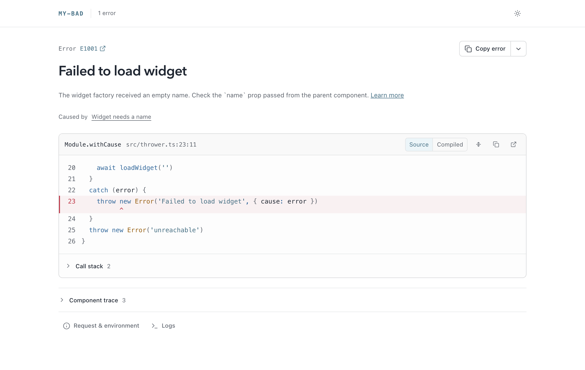
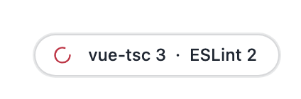
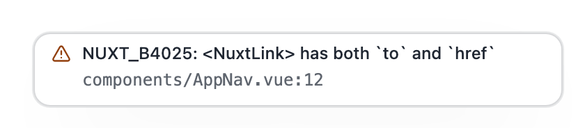
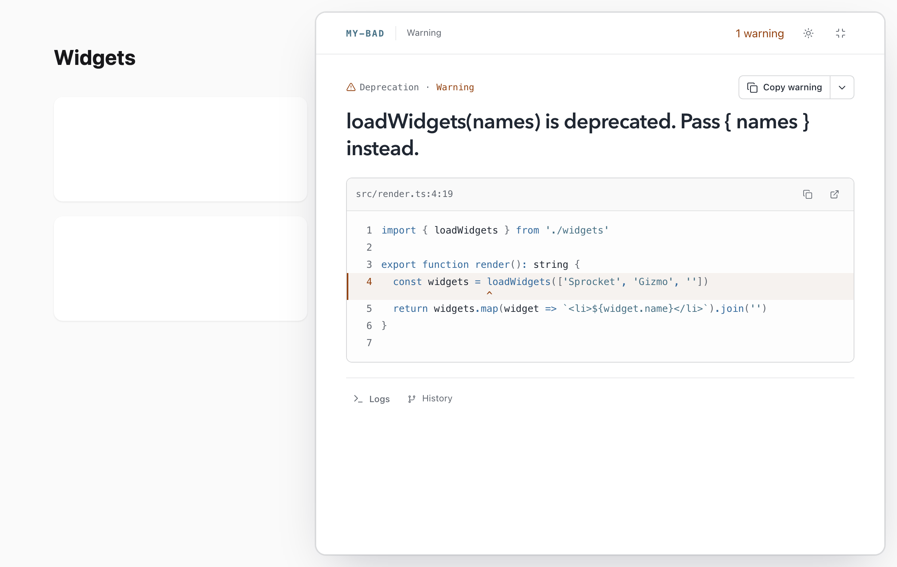
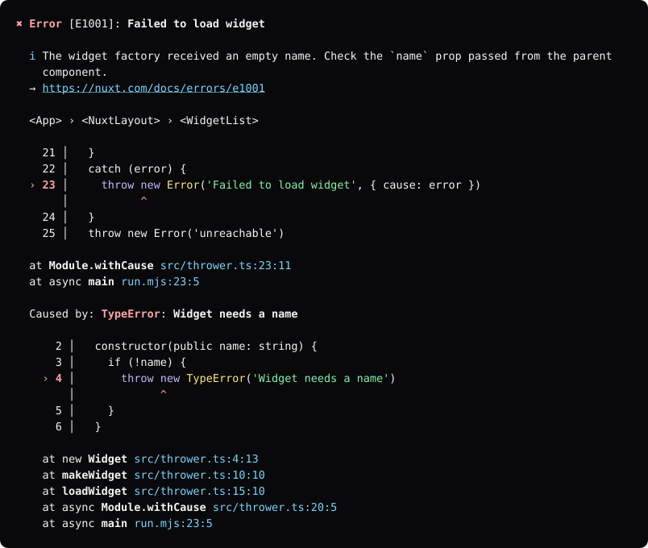

# Rendering

A report renders in several formats. This page covers each renderer, its options, and how to theme the HTML output.

| Function | Output | Use it for |
| --- | --- | --- |
| `renderPage` | A complete HTML document | The response to a failed page request. |
| `renderOverlay`, `injectOverlay` | HTML to add to an existing page | A framework's own error page. |
| `renderBadge` | A small script tag | Every page in development. |
| `renderAnsi` | ANSI text | The terminal. |
| `toMarkdown` | Markdown | GitHub issues and prompts for coding agents. |
| `serializeReport` | A report with relative paths | JSON responses. |

## Error page

`renderPage` returns a complete HTML document for a report:

```ts
import { renderPage } from 'my-bad'

res.end(renderPage(report, { cwd, channel: '/__my-bad' }))
```

<picture>
  <source media="(prefers-color-scheme: dark)" srcset="https://raw.githubusercontent.com/danielroe/my-bad/main/assets/page-dark.png">
  
</picture>

With a `channel`, the page connects to the [live channel](./channel.md). It swaps in new errors as they arrive, and reloads once its error is retired.

### HTML options

`renderPage`, `renderOverlay`, and `injectOverlay` take these options:

| Option | Default | Description |
| --- | --- | --- |
| `cwd` | | Directory that paths are shown relative to. |
| `channel` | | Base path of the live channel, for example `/__my-bad`. Without it, the page is static. |
| `requestId` | | Id of the request that the page was rendered for. The channel uses it to match errors to the page. See [Errors and requests](./channel.md#errors-and-requests). |
| `history` | | Entries to list before the page connects to the channel. `channel.history` holds every stored report, so don't pass it to pages that untrusted callers can load. |
| `environment` | | Where the error happened, for example `Server` or `Client`. Shown next to the error name. |
| `theme` | | See [Theming](#theming). |
| `editor` | `vscode` | URL scheme for opening files when the channel has no `open` action. |
| `assets` | | URLs of the client script and stylesheet. See [Serve the client assets separately](#serve-the-client-assets-separately). |
| `maxMessageLength` | `1000` | Characters of the message shown before a button that expands it. |
| `rawStack` | `false` | Embed the raw stack in the page. Nothing in the page reads it. The channel also serves it at `{channel}/history/{id}`. |

`renderPage` also takes these options:

| Option | Description |
| --- | --- |
| `title` | Document title. Defaults to the error name and message. |
| `head` | Extra markup for `<head>`. |
| `inject` | Raw HTML added before `</body>`. |

## Overlay

The overlay shows a report on top of an existing page, such as the error page of a framework. It renders in a shadow root, so the page styles don't affect it. You can minimise it to a small preview to see the page behind it.

Use `injectOverlay` to add it to a page:

```ts
import { injectOverlay } from 'my-bad'

html = injectOverlay(html, report, { channel: '/__my-bad', startMinimized: status < 500 })
```

`injectOverlay` inserts the overlay before `</body>`, or appends it. Don't use `html.replace('</body>', ...)` with the output of `renderOverlay`. The inlined client contains `$` sequences that `String.replace` treats as patterns.

The overlay takes the [HTML options](#html-options), and these:

| Option | Default | Description |
| --- | --- | --- |
| `startMinimized` | `false` | Mount minimised. Without it, the overlay remembers the last state the user picked in this origin, but only to mount minimised. |
| `dock` | `bottom-right` | Corner that the minimised overlay starts in, until the user moves it: `bottom-right`, `bottom-left`, `top-right`, or `top-left`. |
| `tag` | `my-bad-overlay` | Custom element name of the overlay. |

Errors that arrive over the channel don't change whether the overlay is minimised.

## Badge

`renderBadge` adds a small loader to a page. Add it to every page that your dev server renders:

```ts
import { renderBadge } from 'my-bad'

html += renderBadge({ channel: '/__my-bad' })
```

The badge renders nothing until something concerns the page:

- **An error** mounts the overlay, minimised unless you pass `startMinimized: false`.
- **Warnings** show a count in the corner. Selecting the count opens the warnings in a panel beside the page.
- **Problem sets** show a pill beside the count, with one entry for each source or `group`. Selecting an entry opens its problems in a drawer beside the page. See [Publish problems](./problems.md).

<picture>
  <source media="(prefers-color-scheme: dark)" srcset="https://raw.githubusercontent.com/danielroe/my-bad/main/assets/badge-problems-dark.png">
  
</picture>

A new warning, or a new error while the overlay is hidden, grows the count into a card for a few seconds. The card shows the report and where it points. It stays open while you hover or focus it.

<picture>
  <source media="(prefers-color-scheme: dark)" srcset="https://raw.githubusercontent.com/danielroe/my-bad/main/assets/badge-dark.png">
   has both to and href, with components/AppNav.vue:12 beneath it" width="428">
</picture>

While no error is open, the warnings panel leaves the page usable. It moves on to the next warning as you retire each one.

<picture>
  <source media="(prefers-color-scheme: dark)" srcset="https://raw.githubusercontent.com/danielroe/my-bad/main/assets/warnings-dark.png">
  
</picture>

### Reload a page when its error is fixed

The badge dispatches a `my-bad:error:clear` event on `window` when the error of the page is retired. Listen for it to reload the page:

```ts
addEventListener('my-bad:error:clear', () => location.reload())
```

### Badge options

`renderBadge` takes the `cwd`, `requestId`, `environment`, `theme`, `editor`, `maxMessageLength`, `dock`, and `tag` options of the [overlay](#overlay), and these:

| Option | Default | Description |
| --- | --- | --- |
| `channel` | | Base path of the live channel. Required. |
| `startMinimized` | `true` | Mount the overlay for an error minimised. |
| `assets` | | URLs for `script`, `styles`, and `badge`, instead of the ones the channel serves. |
| `awaitHost` | `0` | Milliseconds to wait for Vite DevTools before mounting the overlay. See [Wait for DevTools](./vite.md#wait-for-devtools-before-showing-the-overlay). |

The badge script is about 19 kB. It loads from the channel at `{channel}/badge.js`, and loads the overlay only when the page needs it. The badge closes its connection while the tab is in the background.

An overlay rendered into the same page with the same `tag` joins the badge, instead of mounting a second time. The two share one connection.

### Mix versions of my-bad

A page can come from a different version of `my-bad` than the channel, for example when a framework CLI owns the channel. The badge loads its scripts from the channel, so the badge and the overlay that it mounts match the channel. `renderPage` and `renderOverlay` inline the scripts of their own version, unless you pass `assets` with the URLs that the channel serves.

The channel caches a script forever when the request names the hash of its build in `?v=`. With any other hash, it serves the script uncached. A channel from a version without `badge.js` responds with a 404, so pass `assets` when you don't control the version of the channel.

## Terminal output

`renderAnsi` renders a report as text for the terminal:

```ts
import { renderAnsi } from 'my-bad'

console.error(renderAnsi(report, { cwd }))
```



In terminals that support them, file locations are OSC 8 hyperlinks.

| Option | Default | Description |
| --- | --- | --- |
| `cwd` | `process.cwd()` | Directory that paths are shown relative to. |
| `width` | Terminal width, or `80` | Width to wrap to. The minimum is `40`. |
| `colors` | Detected | Force colours on or off. |
| `hyperlinks` | Detected | Force OSC 8 hyperlinks on or off. |
| `verbose` | `false` | Expand vendor and native frames, and print sections. |
| `snippetContext` | `2` | Lines of source shown around the error line. |
| `icon` | `true` | Print a leading `✖` or `⚠`. Turn it off when your logger prints its own badge. |
| `maxMessageLength` | `1000` | Characters of each message printed before the rest is summarised. |

## Markdown and JSON

`toMarkdown` renders a report as Markdown, for a GitHub issue or a prompt for a coding agent:

```ts
import { toMarkdown } from 'my-bad'

const markdown = toMarkdown(report, { cwd })
```

Pass `allFrames: true` to include vendor and native frames.

`serializeReport` returns a copy of the report for JSON responses. With `cwd`, it rewrites the file paths of frames and the component trace inside `cwd` as relative paths. It leaves other paths as they are, including the raw stack and the raw text of each frame:

```ts
import { serializeReport } from 'my-bad'

res.end(JSON.stringify(serializeReport(report, { cwd })))
```

Pass `snippets: false` to drop the source snippet of each frame. The snippet of compiled code, in `frame.compiled.snippet`, stays.

## Serve the client assets separately

By default, `renderPage` and `renderOverlay` inline the client script and stylesheet, about 60 kB in total. To load them from separate URLs, pass `assets`:

```ts
import { renderPage } from 'my-bad'

renderPage(report, {
  channel: '/__my-bad',
  assets: { script: '/__my-bad/client.js', styles: '/__my-bad/client.css' }
})
```

The channel serves both files under its base path. To serve them yourself, use the strings in `clientAssets.script`, `clientAssets.styles`, and `clientAssets.badge`.

Theme overrides stay inline, so a shared stylesheet still lets each response use its own theme.

## Theming

The HTML output follows `prefers-color-scheme`, and lets the user pick a colour scheme. You can restyle it with a few CSS custom properties, without forking the stylesheet.

`my-bad/presets` exports a theme for Nuxt:

```ts
import { renderPage } from 'my-bad'
import { nuxtTheme } from 'my-bad/presets'

renderPage(report, { theme: nuxtTheme })
```

To build your own theme, pass these fields:

```ts
renderPage(report, {
  theme: {
    name: 'Acme',
    url: 'https://acme.dev',
    logo: '<svg viewBox="0 0 32 32">…</svg>',
    accent: '#ff4f81',
    vars: { '--mb-bg': '#0b0b12', '--mb-font-sans': 'Inter, sans-serif' },
    css: '.mb-name { text-transform: uppercase }',
    scheme: 'dark',
  },
})
```

| Field | Description |
| --- | --- |
| `name` | Product name shown in the header. |
| `url` | Link for the product name and logo. |
| `logo` | Inline SVG markup, drawn 20 px tall in `currentColor`. It isn't escaped, so pass only trusted markup. |
| `accent` | Accent colour, in any CSS colour format. It colours links, selected controls, the progress bar, and focus rings. |
| `vars` | CSS custom properties to set on the root. |
| `css` | Extra CSS added after the built-in stylesheet. It isn't escaped, so pass only trusted CSS. |
| `scheme` | `light` or `dark`, to force a colour scheme. |

These custom properties drive the rest of the stylesheet:

- `--mb-accent`, `--mb-bg`, and `--mb-fg` for colours.
- `--mb-font-sans`, `--mb-font-display`, and `--mb-font-mono` for fonts.
- `--mb-radius` for corners.
- `--mb-tk-*` for syntax colours, for example `--mb-tk-keyword`.

Text shades, borders, and surfaces mix from the colours. On light backgrounds, the accent darkens for small text, so it stays readable.
