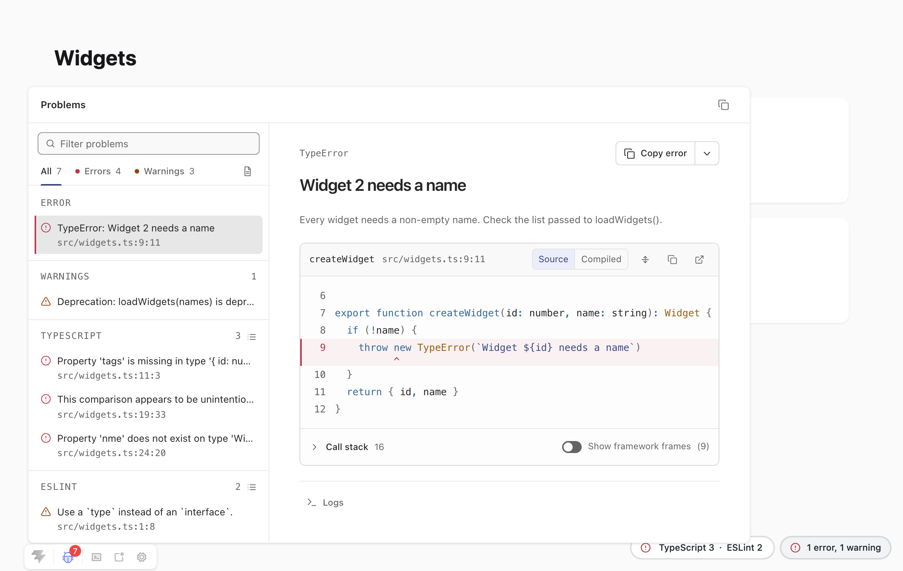

# Use with Vite

The Vite plugin connects `my-bad` to a Vite dev server. It maps frames through the Vite module graph, shows compile errors in an overlay, and mounts the live channel. It runs only during `vite dev`.

The plugin requires Vite 6 or later.

## Add the plugin

Add `myBad()` to your Vite config:

```ts
import { myBad } from 'my-bad/vite'
import { defineConfig } from 'vite'

export default defineConfig({
  plugins: [
    myBad()
  ]
})
```

The plugin then does the following:

- Mounts the [live channel](./channel.md) at `/__my-bad`.
- Replaces the Vite error overlay for compile errors with the `my-bad` overlay.
- Injects a small client into `index.html`, so a running app shows the overlay.
- Clears the overlay when the next update or full reload succeeds.
- Reads sources only where Vite itself would serve them, following `server.fs.allow` and `server.fs.deny`.

## Render server errors

If you render pages on the server, use `useMyBad(server)` in your own middleware. It returns a context with the same configuration as the plugin.

This example renders every page on the server, so it sets `appType: 'custom'`. Its middleware runs after the Vite middlewares, so Vite still serves modules and assets:

```ts
import type { Plugin } from 'vite'
import { myBad, useMyBad } from 'my-bad/vite'
import { defineConfig } from 'vite'

const ssr: Plugin = {
  name: 'ssr',
  configureServer(server) {
    return () => server.middlewares.use(async (req, res) => {
      try {
        const { render } = await server.ssrLoadModule('/src/entry-server.ts')
        res.end(await render(req.url))
      }
      catch (error) {
        const ctx = useMyBad(server)!
        const report = await ctx.emit(error)
        res.statusCode = 500
        res.setHeader('content-type', 'text/html')
        res.end(ctx.page(report))
      }
    })
  },
}

export default defineConfig({
  appType: 'custom',
  plugins: [
    myBad(),
    ssr
  ]
})
```

`useMyBad(server)` returns `undefined` until the plugin has configured the server. The context has these members:

| Member | Description |
| --- | --- |
| `channel` | The live channel. |
| `base` | The channel base path, for example `/__my-bad`. |
| `loaders` | The source loaders the plugin uses. |
| `report(error, options?)` | Builds a report with the plugin's loaders and presets. |
| `emit(error, options?)` | Builds a report, publishes it, and shows it in the overlay of open pages. |
| `clear(id?)` | Retires one error, or every error without an id. |
| `page(report, options?)` | Renders a full error page connected to the channel. |
| `overlay(report, options?)` | Renders an overlay connected to the channel. |

To show the badge on your server-rendered pages, add `renderBadge({ channel: ctx.base })` to their `<head>`. See [Badge](./rendering.md#badge).

## Add Vite DevTools

If you use [Vite DevTools](https://devtools.vite.dev/guide/), `myBad()` adds a `my-bad` dock to it. You don't need to configure `my-bad`.

To add the dock:

1. Install `@vitejs/devtools`:

   ```sh
   npm install -D @vitejs/devtools
   ```

2. Enable DevTools in your Vite config:

   ```ts
   import { myBad } from 'my-bad/vite'
   import { defineConfig } from 'vite'

   export default defineConfig({
     devtools: true,
     plugins: [
       myBad()
     ]
   })
   ```

The Vite DevTools documentation lists the Vite versions it supports. To leave the dock out, pass `myBad({ devtools: false })`.

<picture>
  <source media="(prefers-color-scheme: dark)" srcset="https://raw.githubusercontent.com/danielroe/my-bad/main/assets/devtools-dark.png">
  
</picture>

### How pages behave with DevTools

With DevTools running, errors no longer take over the page:

- The badge shows on every page and opens the dock instead of the overlay.
- The dock lists the open error, the warnings, and every problem set. It shows the one you pick the way the overlay does.
- The dock icon in the DevTools bar counts them, in red while any of them is an error.
- The open error and each problem set also appear in the DevTools messages panel, with their file position.

The messages panel shows a spinner while a problem set is `checking`. Its actions show an entry in the dock, or show the full list of a problem set. The badge announces new reports, so DevTools shows no toast for them.

A problem set can name another DevTools dock in `devtoolsDock`. The badge entry for that set then switches to that dock, and so do the "full list" actions. An entry that counts a `group` of several sources still opens the `my-bad` dock. See [Problem metadata](./problems.md#problem-metadata).

### Add the dock for a channel outside the plugin

A framework can serve the channel from its own dev server instead of the Vite plugin. In that case, add `myBadDevTools` next to the badge that the framework renders:

```ts
import { myBadDevTools } from 'my-bad/vite'
import { defineConfig } from 'vite'

export default defineConfig({
  devtools: true,
  plugins: [
    myBadDevTools({
      channel: '/__my-bad',
      onRegister: () => channel.setDevTools(true)
    })
  ]
})
```

Call `channel.setDevTools(true)` from `onRegister`. If the channel lives in another process, relay the call to it. `myBad()` does this for its own channel.

`myBadDevTools` takes these options:

| Option | Description |
| --- | --- |
| `channel` | Base path of the channel. Required. |
| `id` | Dock id. Default `my-bad`. |
| `title` | Dock title. Default `my-bad`. |
| `icon` | An Iconify name or an image URL. |
| `onRegister` | Called once DevTools registers the dock. |

The channel serves the dock page at `{channel}/panel` and its script at `{channel}/devtools.js`.

### Wait for DevTools before showing the overlay

Until the DevTools client starts, the badge mounts the overlay for an error as usual. To give DevTools time to take over first, pass `awaitHost` in milliseconds:

```ts
renderBadge({ channel: '/__my-bad', awaitHost: 3000 })
```

The badge waits only when the channel reports a registered dock. Pages without DevTools mount the overlay straight away. Keep the wait short: an untrusted DevTools client never runs the dock script, so the badge waits the full time.

## Mount the client without `index.html`

The plugin injects its client through `index.html`. If your app serves HTML that doesn't pass through Vite's `transformIndexHtml`, install the client from your client entry instead:

```ts
import { installMyBadClient } from 'my-bad/vite/client'

installMyBadClient()
```

The client mounts the overlay that the plugin pushes over the HMR connection, and removes it when the error clears.

## Plugin options

`myBad()` takes these options:

| Option | Default | Description |
| --- | --- | --- |
| `channel` | `true` | Mount the live channel and inject the client. Pass [channel options](./channel.md#channel-options) to configure it, or `false` to turn it off. |
| `base` | `/__my-bad` | Base path of the channel. |
| `presets` | `[]` | [Report presets](./reports.md#presets). |
| `report` | | [Report options](./reports.md#report-options), except `loaders` and `presets`. |
| `overlay` | | [Overlay options](./rendering.md#overlay), except `channel` and `cwd`. |
| `inlineClient` | `false` | Inline the client script and stylesheet into every page, instead of serving them as two cacheable files. |
| `replaceOverlay` | `true` | Replace the Vite error overlay for compile errors. |
| `devtools` | `true` | Add the dock to Vite DevTools when it's installed. |

By default, the plugin creates the channel with `open: true`, and confines `open` requests to `server.fs.allow`. If you pass channel options, set `open` yourself.
